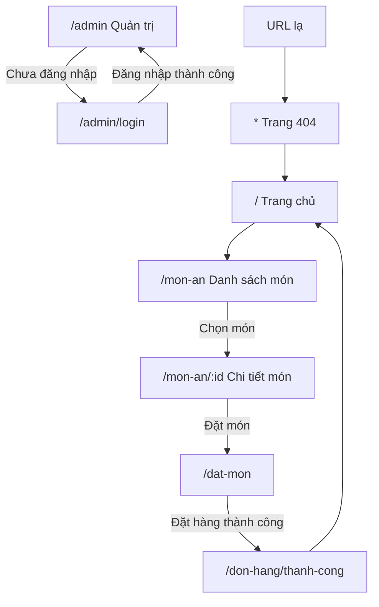

# ROUTES — Quán Huế Xưa

## 1. Phạm vi

Ứng dụng giới thiệu món ăn Huế, cho phép khách tìm kiếm món, xem chi tiết và tạo đơn đặt món. Sprint 1 ưu tiên bộ tuyến và hai màn hình đầu tiên: danh sách món ăn và chi tiết món ăn.

## 2. Bảng tuyến

| Đường dẫn | Màn hình | Ai vào | Dữ liệu | Trạng thái cần xử lý | Đi tiếp |
|---|---|---|---|---|---|
| `/` | `HomePage` | Mọi người | Danh sách món ăn, từ khóa `q` trên URL | Có dữ liệu; không có món phù hợp | `/mon-an/:id` |
| `/mon-an` | `MonAnListPage` | Mọi người | Danh sách món ăn, từ khóa `q` trên URL | Có dữ liệu; danh sách rỗng; không có kết quả | `/mon-an/:id` |
| `/mon-an/:id` | `MonAnDetailPage` | Mọi người | Một món ăn theo `id` | Có dữ liệu; id không hợp lệ; không tìm thấy | `/dat-mon` hoặc quay lại danh sách |
| `/dat-mon` | `OrderPage` | Mọi người | Giỏ hàng và thông tin người đặt | Giỏ hàng rỗng; dữ liệu hợp lệ; lỗi xác thực | `/don-hang/thanh-cong` |
| `/don-hang/thanh-cong` | `OrderSuccessPage` | Mọi người có đơn vừa tạo | Thông tin đơn hàng trong state hoặc dữ liệu lưu tạm | Thiếu thông tin đơn thì quay về `/` | `/` |
| `/admin` | `AdminPage` | Đã đăng nhập | Dữ liệu quản trị | Chưa đăng nhập thì chuyển `/admin/login` | `/admin/mon-an` |
| `/admin/login` | `AdminLoginPage` | Mọi người | Thông tin đăng nhập | Thiếu thông tin hoặc sai thông tin | `/admin` |
| `*` | `NotFoundPage` | Mọi người | Không cần | URL không tồn tại | `/` |

> Trong Sprint 1, trang đặt món và các trang quản trị có thể là màn hình khung chỉ có tiêu đề; không mở rộng nghiệp vụ ngoài phạm vi hai màn hình danh sách và chi tiết.

## 3. Sơ đồ luồng

## 4. Quy ước dữ liệu và trạng thái

- Dữ liệu món ăn phải được lấy qua hàm service, không khai báo mảng món ăn trực tiếp trong component trang.
- `id` lấy từ `useParams()` là chuỗi; phải chuyển kiểu phù hợp trước khi so sánh với `id` kiểu số.
- Tìm kiếm đọc/ghi tham số `q` trên URL để có thể tải lại hoặc chia sẻ đường dẫn tìm kiếm.
- Danh sách rỗng và không có kết quả tìm kiếm cần thông báo riêng, dễ hiểu.
- ID không hợp lệ hoặc không tồn tại phải hiển thị thông báo “Không tìm thấy món ăn”, không để trang trắng hoặc phát sinh lỗi Console.
- Mọi layout có tuyến con phải render `<Outlet />`; phải khai báo tuyến `*` cho trang 404.
- Tuyến `/admin` dùng `ProtectedRoute`. Với bài thực hành, trạng thái đăng nhập có thể mô phỏng; không xem đây là cơ chế bảo mật production.
